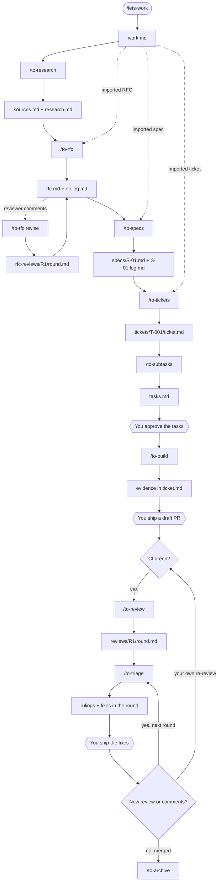

# work

A file-backed workflow from RFC to merged pull request.
Eleven small skills, each doing one step, each reading and writing a local work directory so that any session resumes from disk instead of from chat history.

## Why

Long work outlives a session.
Compacting or restarting a conversation loses the reasons behind decisions first.
Here every step is saved as it happens: the sources that were read, each question and your answer, the specs, the tickets, what a review found and how you ruled on it.

## The skills

| Skill | Run it when | Reads | Writes |
|---|---|---|---|
| `/lets-work` | always first: a new work, or new material for one | what you already have (Notion, Jira, issues, files) | `work.md`, imported documents |
| `/work-status` | you come back, or want to know what is next | frontmatter of every document | nothing |
| `/to-research` | first, to find out what is true before deciding (a spike) | the sources you point at | `sources.md`, `research.md` |
| `/to-rfc` | the problem needs shaping, or reviewers commented on the RFC | `research.md`, `sources.md` | `rfc.md`, `rfc.log.md`, `rfc-reviews/R<n>/` |
| `/to-specs` | the direction is known and needs detail | RFC, sources | `specs/INDEX.md`, one spec and one log each |
| `/to-tickets` | specs are accepted, or you have one bug or small change | specs | `tickets/T-001-<slug>/ticket.md` |
| `/to-subtasks` | a ticket is about to be built | the ticket, the code | `tasks.md` |
| `/to-build` | the task list is approved | `tasks.md` | `tasks.md`, evidence in `ticket.md` |
| `/to-review` | your draft PR is up and CI is green | the PR diff, the ticket | `reviews/R<n>/round.md` |
| `/to-triage` | a round is open, or reviewers commented on your PR | the round, the PR comments | the round, new tickets for deferred items |
| `/to-archive` | the work is finished | the work directory | the archive |

Every skill takes a work id, or the path of a document that carries one.
None of them commits, pushes, posts or publishes; shipping stays yours.

## The flow



## Starting points

`/lets-work` is always the first step.
It asks once what already exists, imports each item verbatim into `sources.md`, maps it into the work's documents with `status: imported`, and names the next step.
The owning skill then challenges what was imported instead of writing it again.

| Situation | What you give `/lets-work` | Then |
|---|---|---|
| Personal project, a quick change | a description | `/to-tickets`, `/to-subtasks`, `/to-build` |
| Personal project, a feature with no RFC | a description | `/to-research` if needed, `/to-specs`, `/to-tickets` |
| Job, a new feature from zero | a description, the Slack threads and PRD links | `/to-research`, `/to-rfc`, `/to-specs`, `/to-tickets` |
| Job, the RFC is already in Notion | the Notion URL | `/to-rfc` challenges it, then `/to-specs` |
| Job, the specs were written before | their paths or URLs | `/to-specs` challenges them, then `/to-tickets` |
| Job, the tickets already exist in Jira | the Jira keys | `/to-tickets` challenges them, then `/to-subtasks` |
| Open source, an issue you will fix | the issue URL | `/to-tickets` challenges it, then `/to-subtasks` |
| A bug | the bug report or its ticket key | `/to-tickets`, `/to-subtasks` |
| A work already open, with new material | `/lets-work <work-id>` and the new links | the owning skill of whatever was added |

`/to-review` and `/to-triage` are for your own tickets: someone else's PR, an open-source one included, is reviewed with the review command instead.
In a repo with no CI, `/to-review` proceeds and records it; in a repo where you push branches without PRs, it reviews the branch against the default branch.

## Where the files live

```text
~/.work/<repo>/<work-id>/
  work.md
  sources.md
  research.md
  glossary.md
  adr/
  rfc.md
  rfc.log.md
  rfc-reviews/
    R1/round.md
  specs/
    INDEX.md
    S-01-<slug>.md
    S-01-<slug>.log.md
  tickets/
    T-001-<slug>/
      ticket.md
      ticket.log.md
      tasks.md
      reviews/
        R1/round.md
        R2/round.md
```

The root is `~/.work`, or the `WORK_ROOT` environment variable.
`<repo>` is the name of the main checkout, so a git worktree shares the work of its repository.
Closed work moves to `~/.work-archive/`; nothing is ever deleted.

## A worked example

```text
/lets-work consent-v2 <slack thread> <PRD link>
/to-research consent-v2 <slack thread> <notion page>
/to-rfc consent-v2
```

Reviewers comment on the published RFC:

```text
/to-rfc consent-v2 revise
```

A day later, in a fresh session:

```text
/work-status consent-v2
/to-specs consent-v2
/to-tickets consent-v2
```

One ticket, from plan to merge:

```text
/to-subtasks consent-v2 T-001      approve the task list
/to-build consent-v2 T-001         tasks run, criteria checked, nothing committed
/ship                              your own command: draft PR
/to-review consent-v2 T-001        once CI is green: round R1
/to-triage consent-v2 T-001        rule on each item, fixes applied at the end
/ship                              your own command: push the fixes
/to-triage consent-v2 T-001 comments   a teammate reviewed: round R2
/to-archive consent-v2
```

## Setup

1. Add the bundle to the project with kura.
2. Allow your agent to write to the work root, once, in your user-level settings. For Claude Code:

   ```json
   {
     "permissions": {
       "allow": ["Edit(~/.work/**)", "Edit(~/.work-archive/**)"]
     },
     "sandbox": {
       "filesystem": {
         "allowWrite": ["~/.work", "~/.work-archive"]
       }
     }
   }
   ```

A skill that cannot write to the root stops and names the missing entry.
It never falls back to a directory inside the repository.

## What it relies on

- The staff-engineer seats installed in the project, which `/to-subtasks` assigns and `/to-build` dispatches.
- The `code-reviewer` agent, which `/to-review` runs with the nit cap lifted and a blind sample.
- `acceptance-checker`, this bundle's only agent: read-only, it verifies each acceptance criterion by the method the ticket names.
- `research`, `grilling` and `domain-modeling`, declared in `bundle.json`; `unslop` is global and applied directly.

## Deprecated by this bundle

The registries carry the record: a `deprecated` object (`since`, `replaced_by`, `reason`) on each row it replaces, in `skill-registry.json`, `agent-registry.json` and `bundle-registry.json`.
Upstream skills are covered too, since their rows are local even though their files are overwritten on every sync.
Local artifacts also keep a `[deprecated]` description prefix, because the description is the only part an agent sees when it picks a skill.

Kept on purpose, because something in use loads them: `jira` (`ac`, `research`, `pr`), `diagram` (`ship`, `pr`), `planning-and-task-breakdown` and `incremental-implementation` (`architect`), `agent-audit` (the setup reviewers), `how`, `teach` and `unslop` (`teammate`), and `handoff` (the global instructions offer it before a session gets expensive).
